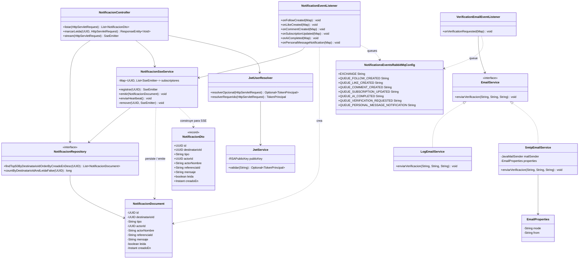

# artagram-notifications

Microservicio de notificaciones de Artagram: centro de notificaciones in-app
(persistido en Mongo + entregado en vivo por SSE) y envío de email. Consolida
dos responsabilidades que antes vivían repartidas en otros servicios y que no
les pertenecían:

- **`artagram-chat`** tenía `NotificacionSseService`, `NotificacionDocument` y
  `ChatEventListener` (la parte de notificaciones, no la de mensajería de
  sala — eso se queda en chat).
- **`artagram-auth`** tenía `EmailService`/`LogEmailService`/`SmtpEmailService`
  y llamaba a `enviarVerificacion(...)` directamente desde `AuthService` al
  registrar un usuario.

Ambas piezas quedan como código muerto en sus repos originales (no se borran
en esta migración — decomiso es un paso posterior) y el camino nuevo pasa por
aquí.

## Qué hace

- `GET /api/notificaciones` — últimas 50 notificaciones del usuario autenticado.
- `POST /api/notificaciones/{id}/leer` — marcar una como leída.
- `GET /api/notificaciones/stream` (SSE) — stream en vivo + heartbeat cada 25s.
- Consume de RabbitMQ: `follow.created`, `like.created`, `comment.created`,
  `subscription.updated` (solo si `premium=true`), `ai.completed` → crea un
  `NotificacionDocument` y lo empuja por SSE si el usuario está conectado.
- Consume `user.verification.requested` (nuevo, publicado por `artagram-auth`)
  → envía el email de verificación (modo `log` o `smtp` según `EMAIL_MODE`).

## Por qué un vhost propio en RabbitMQ

Decisión explícita: aislar el tráfico de notificaciones del resto de
servicios sin pagar/operar una instancia de broker separada. Este servicio
se conecta al vhost `notifications` (no al `/` que usan auth/users/feed/chat/
canvas/ai-worker/media-worker). Un vhost es una partición dura — el exchange
`artagram.events` que declara `NotificationsEventsRabbitMqConfig` es una
copia *local* a ese vhost, no el mismo objeto que el de `/`. El puente real
(reenviar todo lo publicado en `/` hacia este vhost) es un **Shovel** de
RabbitMQ configurado en `artagram-infra/rabbitmq/definitions.json` — no hay
nada en el código de este servicio que dependa de eso; desde su punto de
vista simplemente hay mensajes en sus colas `notifications.*`.

## Limitación conocida (SSE en memoria)

`NotificacionSseService` guarda los `SseEmitter` en un mapa en memoria de la
instancia. Si este servicio escala a más de una réplica, un emitter conectado
a la instancia A no recibe lo que se emite desde la instancia B. El modelo
correcto para eso es el que ya usa
`artagram-canvas` (`RealtimeBroadcaster`, relay vía Redis Pub/Sub) — no se
introduce esa dependencia aquí sin una necesidad concreta de escalar
horizontalmente.

## Variables de entorno

Ver `.env.example`. Las relevantes:

| Variable | Default | Nota |
|---|---|---|
| `SPRING_DATA_MONGODB_URI` | `mongodb://...db_notificaciones` | DB creada de forma perezosa por Mongo |
| `RABBITMQ_VHOST` | `notifications` | único servicio que no usa `/` |
| `RABBITMQ_USER`/`RABBITMQ_PASSWORD` | `notifications`/`notifications_secret` | credenciales scoped solo a ese vhost |
| `JWT_PUBLIC_KEY_PATH` | `../artagram-infra/secrets-dev/jwt-public.pem` | misma llave que el resto de servicios |
| `EMAIL_MODE` | `log` | `log` (solo loguea) o `smtp` |

## Cómo correrlo en local

```
docker compose -f ../artagram-infra/compose.yml -f ../artagram-infra/compose.services.yml \
  up -d --build artagram-notifications
curl -s http://localhost:8090/actuator/health
```

Requiere que `artagram-infra` tenga provisionado el vhost `notifications` y
el shovel que lo puentea con `/` (ver su propio README/definitions.json).

## Descripción del servicio

`artagram-notifications` es el microservicio responsable de todo lo que un
usuario de Artagram recibe como notificación — tanto el centro de
notificaciones in-app (seguidores nuevos, likes, comentarios, suscripción
premium, análisis de IA listo), entregado en vivo por SSE y respaldado en
MongoDB, como el envío del email de verificación de cuenta. Existe como
servicio separado porque antes esta responsabilidad estaba repartida en
lugares que no le pertenecían: `artagram-chat` cargaba con la lógica de
notificaciones (mezclada con su propia lógica de mensajería de salas) y
`artagram-auth` enviaba el correo de verificación directamente desde
`AuthService`. Consolidar ambas piezas aquí separa una responsabilidad
transversal (avisar al usuario de algo que pasó en otro dominio) de los
servicios de dominio que la originan, que ahora solo publican un evento en
RabbitMQ y se olvidan de cómo se entrega.

## Responsabilidades

- Exponer `GET /api/notificaciones` (últimas 50 notificaciones del usuario
  autenticado) y `POST /api/notificaciones/{id}/leer` (marcar como leída),
  resolviendo el usuario a partir del JWT RS256 emitido por `artagram-auth`
  (`JwtUserResolver` / `JwtService`).
- Exponer `GET /api/notificaciones/stream` como stream SSE en vivo
  (`NotificacionSseService`), con heartbeat cada 25 segundos para mantener la
  conexión abierta y limpiar emitters muertos.
- Escuchar en RabbitMQ (vhost `notifications`) los eventos `follow.created`,
  `like.created`, `comment.created`, `subscription.updated` (solo si
  `premium=true`), `ai.completed` y `personal.message.notification`
  (publicado por `artagram-chat` al enviarse un mensaje directo), y por cada
  uno construir y persistir un `NotificacionDocument` en Mongo, empujándolo
  por SSE si el destinatario está conectado (`NotificationEventListener`).
- Escuchar `user.verification.requested` (publicado por `artagram-auth`, que
  sigue siendo dueño del token y su expiración) y entregar el email de
  verificación por el canal configurado (`VerificationEmailEventListener`).
- Decidir el canal de envío de email (solo log en desarrollo, SMTP real en
  producción) de forma intercambiable vía `EMAIL_MODE`, sin que el resto del
  servicio dependa de cuál implementación esté activa (`EmailService`,
  `LogEmailService`, `SmtpEmailService`).
- Declarar y enlazar sus propias colas/bindings sobre el exchange
  `artagram.events` dentro del vhost `notifications`, con dead-letter exchange
  propio por cola (`NotificationsEventsRabbitMqConfig`).

## Diagrama de clases



## Atributos de calidad

### Escalabilidad

Documenta la limitación real y aceptada del servicio: los emitters SSE viven
solo en memoria de cada instancia, sin relay compartido (a diferencia de
`artagram-canvas`, que resuelve el mismo problema con `RealtimeBroadcaster`
sobre Redis Pub/Sub).

- **Fuente**: Un evento de dominio (p.ej. `like.created`) publicado por
  `artagram-feed` y reenviado por el Shovel hasta el vhost `notifications`.
- **Estímulo**: El evento es consumido por el `NotificationEventListener` de
  la instancia B del servicio, mientras el usuario destinatario mantiene su
  conexión `GET /api/notificaciones/stream` abierta contra la instancia A.
- **Artefacto**: `NotificacionSseService`, concretamente el
  `Map<UUID, List<SseEmitter>> subscriptores` mantenido en memoria local de
  cada instancia (sin backing store ni Pub/Sub compartido).
- **Ambiente**: Producción, con el servicio escalado horizontalmente a dos o
  más tareas ECS Fargate detrás del load balancer.
- **Respuesta**: La notificación se persiste correctamente en MongoDB (todas
  las instancias comparten la misma base), pero la instancia B no tiene
  ninguna referencia al `SseEmitter` abierto en la instancia A, por lo que no
  puede empujarle el evento; el usuario no la recibe en tiempo real.
- **Medida de respuesta**: 0% de entrega en tiempo real para el caso
  cross-instancia (frente a 100% cuando el emitter y el evento caen en la
  misma instancia); la notificación queda disponible igualmente en el
  siguiente `GET /api/notificaciones` o al reconectar el stream. Cerrar esta
  brecha requeriría portar el mismo patrón de `artagram-canvas`
  (`RealtimeBroadcaster` con Redis Pub/Sub), deliberadamente no introducido
  aquí mientras no haya necesidad concreta de escalar a más de una réplica.

### Seguridad (aislamiento por vhost de RabbitMQ)

- **Fuente**: Un servicio o credencial del vhost `/` (el que comparten
  auth/users/feed/chat/canvas/ai-worker/media-worker).
- **Estímulo**: Se intenta leer o publicar directamente sobre las colas
  `notifications.*` sin pasar por el puente explícito.
- **Artefacto**: La conexión AMQP de `artagram-notifications`, configurada
  en `application.yml` con `spring.rabbitmq.virtual-host=notifications` y
  credenciales propias (`RABBITMQ_USER`/`RABBITMQ_PASSWORD` distintas a las
  del resto de servicios).
- **Ambiente**: Producción, con RabbitMQ corriendo como una única tarea ECS
  Fargate compartida por todos los microservicios (no un broker dedicado).
- **Respuesta**: Las credenciales y conexiones del vhost `/` no tienen
  visibilidad ni permisos sobre el vhost `notifications` — son particiones
  completamente aisladas dentro del mismo broker. El único puente entre
  ambos es el Shovel declarado en
  `artagram-infra/rabbitmq/definitions.json.template`, que reenvía mensajes
  de forma unidireccional y controlada desde `/` hacia `notifications`.
- **Medida de respuesta**: 0 conexiones cruzadas exitosas entre vhosts fuera
  del Shovel configurado; el aislamiento del tráfico de notificaciones se
  logra sin desplegar ni operar un segundo broker (mismo proceso ECS Fargate,
  mismo costo de infraestructura que una única instancia de RabbitMQ).

### Modificabilidad (canal de envío de email)

- **Fuente**: Equipo de desarrollo/operaciones al preparar un despliegue.
- **Estímulo**: Se necesita cambiar el canal de entrega del email de
  verificación de cuenta — de solo-log en desarrollo a SMTP real en
  producción — sin modificar código.
- **Artefacto**: La interfaz `EmailService` con sus dos implementaciones
  intercambiables, `LogEmailService` y `SmtpEmailService`, seleccionadas por
  Spring vía `@ConditionalOnProperty(prefix = "app.email", name = "mode", ...)`.
- **Ambiente**: Configuración/despliegue, antes de arrancar el contenedor.
- **Respuesta**: Cambiar la variable de entorno `EMAIL_MODE` de `log` a
  `smtp` activa el bean `SmtpEmailService` en lugar de `LogEmailService`;
  `VerificationEmailEventListener` sigue dependiendo únicamente de la
  interfaz `EmailService`, sin ningún cambio de código ni recompilación.
- **Medida de respuesta**: 1 variable de entorno modificada, 0 líneas de
  código cambiadas, 0 recompilaciones; el tiempo de cambio queda acotado al
  tiempo de reinicio del contenedor con la nueva configuración.
